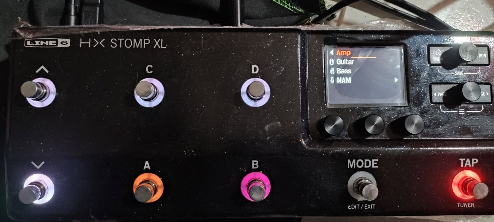

# NAM A2 Lite for the HX Stomp, HX Stomp XL and HX Effects

This repository adds **Neural Amp Modeler (NAM) A2 Lite** to the stock Line 6 firmware 3.80.0 of the HX Stomp, HX Stomp XL and HX Effects. NAM captures then run on the unit's own DSP, like any other block, with a tone stack after the model.

**Not a programmer? Use the setup page: [nocaseguy.github.io/hx-stomp-nam-lite/web/](https://nocaseguy.github.io/hx-stomp-nam-lite/web/).** It builds the firmware from your own Line 6 file, converts your captures and guides you through every step, all in your browser, with nothing to install and nothing uploaded. See [The setup page](#the-setup-page-no-install).

## Supported devices

| Device | Stock firmware (the build checks its MD5) | NAM A2 Lite in the menu | Status |
|---|---|---|---|
| **HX Stomp** | `HX_Stomp_v3.80.0_0x103966115.hxf`<br>`a2cd8f4ae56f49415380270ebc484bf1` | Amp → NAM | **Runs.** This build ran on an HX Stomp from RAM: the on-device test suite passed (48 cases: one to three NAM blocks, both paths, every stock effect category beside NAM, model and preset changes) and every band of the tone stack was measured on the unit. |
| **HX Stomp XL** | `HX_Stomp_XL_v3.80.0_0x103966115.hxf`<br>`329e3a26d60d3de1988b6785fa833ee1` | Amp → NAM | **NAM runs on an XL** (earlier builds; photo below). This ten-knob build has not run on an XL yet; its DSP program, model list and DSP graphs are byte for byte the HX Stomp's. |
| **HX Effects** | `HX_Effects_v3.80.0_0xd97239907.hxf`<br>`7c2ebdf1bffb6bcc5f89dda97f91e40c` | Distortion → Mono | **Runs.** An owner ran the previous build on an HX Effects (with their browser, knob pop-up and scribble strip fixes, PRs #6 and #9). This one adds only the loudness step to the DSP code and hasn't run on an HX Effects yet. See [HX Effects](#hx-effects). |

Not the Helix Floor, LT or Rack: their firmware is a different design. Only firmware 3.80.0: the build refuses any other file.

The block, its ten knobs and the DSP kernel are the same on all three units. What differs:

| | HX Stomp | HX Stomp XL | HX Effects |
|---|---|---|---|
| Where NAM A2 Lite is | Amp → NAM | Amp → NAM | Distortion → Mono |
| The capture's name | the block's title | the block's title | the Model knob's pop-up, and the scribble strip in overview mode |
| File the build writes | `build/HX_Stomp_v3.80.0_NAM_A2_Lite.hxf` | `build/HX_Stomp_XL_v3.80.0_NAM_A2_Lite.hxf` | `build/HX_Effects_v3.80.0_NAM_A2_Lite.hxf` |
| [Try it from RAM](#try-it-first-from-ram) | yes | yes (ran from the setup page) | no |
| Update mode, for [recovery](#recovery) | hold Page Right at power-on | hold Page Right at power-on (not yet tried on an XL) | hold the right arrow (**>**) at power-on |

More in [HX Stomp XL](#hx-stomp-xl) and [HX Effects](#hx-effects).

[](docs/hx-stomp-xl-amp-nam.jpg)

*An HX Stomp XL running NAM A2 Lite: the Amp menu with its NAM folder. Photo: Med Hamza.*

## Demo

[](https://www.youtube.com/watch?v=zQzj0qahJ6E)

Watch it on YouTube: https://www.youtube.com/watch?v=zQzj0qahJ6E

> **Unofficial and experimental.** Not affiliated with, endorsed by or supported by Line 6 or Yamaha Guitar Group. Installing modified firmware is at your own risk and may void your warranty. Read [Install](#install) and [Recovery](#recovery) before you start.

## What's new

- **A tone stack after the model, ten knobs.** Bass (a 150 Hz shelf), Mid (a band you sweep from 150 Hz to 3 kHz, with Q 0.7, 1.4 or 2.8), Treble (a 2.5 kHz band) and High Cut (a low-pass). Each band is ±12 dB, flat at 5.0.
- **Knobs in live order.** Page 1 is Input, Treble, Output: the gain, tone and level you reach for on stage.
- **HX Effects support** (Distortion → Mono; runs on an HX Effects).
- **HX Edit keeps NAM blocks.** NAM A2 Lite takes the place of a stock model HX Edit knows, now **Xenomorph Fuzz Mono**, with its knobs laid out like that model's, so HX Edit keeps the blocks and their settings when it rewrites a preset. HX Edit shows the block as "Xenomorph Fuzz". **MM4 Frequency Shifter**, which the four-knob build replaced, is back.
- All NAM blocks count as effects: the two-amp limit doesn't apply to them.

**Presets saved with an earlier NAM build don't open NAM A2 Lite in this one:** NAM now has another preset ID (555; it was 461, and 147/148 before that). Re-add the block in those presets.

Earlier changes are in [CHANGELOG.md](CHANGELOG.md).

## What you get

- **NAM A2 Lite** under **Amp → NAM** (HX Effects: **Distortion → Mono**), with ten knobs, in this order (the HX Stomp shows three a page):

  | Page | Knob | What it does |
  |---|---|---|
  | 1 | **Input** | Input gain into the capture, −20 to +20 dB; 0 dB (the capture's own level) at 5.0 |
  | 1 | **Treble** | A band at 2.5 kHz (Q 0.7): bite and pick attack. ±12 dB, flat at 5.0 |
  | 1 | **Output** | Output level; 0 dB at 5.0, +12 dB at 10 |
  | 2 | **Polarity** | Normal or Inverted. Inverted flips the output's polarity (phase), exactly. |
  | 2 | **Bass** | A low shelf at 150 Hz. ±12 dB, flat at 5.0 |
  | 2 | **Mid** | A band at Mid Freq, with Q. ±12 dB, flat at 5.0 |
  | 3 | **Model** | Which capture plays: 1–128 is the User IR slot that holds it. A slot holding anything else (a cab IR, or nothing) is silent, and so is any number above 128 (the title then reads `<EMPTY>`). One slot a click. |
  | 3 | **Mid Freq** | Where the Mid band sits: 150 Hz to 3 kHz, 650 Hz by default |
  | 3 | **Q** | The Mid band's width: 0.7 (wide), 1.4 or 2.8 (narrow) |
  | 4 | **High Cut** | A low-pass filter: 10.0 is off (the default), down to 2 kHz at 0.0 |

  The bands come after the model, so they work on any capture, guitar or bass. With every tone knob at 5.0 the block plays the capture exactly as it was captured.

- **A converter** (on the [setup page](https://nocaseguy.github.io/hx-stomp-nam-lite/web/), or `tools/nam2ir.py`) turns a `.nam` file into a `.wav`. HX Edit imports that `.wav` as a User IR. The "IR" is not a sound: it carries the capture's 1,871 weights, and the block loads them from the slot.

- Up to three NAM A2 Lite blocks at once, each with its own capture.
- The capture's name: on the HX Stomp and XL the block's title on the edit screen shows the name of the IR the Model knob selects (the knob itself shows the number); on the HX Effects, see [HX Effects](#hx-effects).

Everything else in the firmware stays stock 3.80.0, except that the build removes **Xenomorph Fuzz Mono** to give NAM its place (Xenomorph Fuzz Stereo stays). A preset of yours that uses Xenomorph Fuzz Mono would open NAM A2 Lite in its place.

## What this repository contains, and what it doesn't

**No Line 6 code or data is in this repository**, and no firmware file is distributed. You need your own copy of the official firmware file. The build reads it on your computer, applies the changes and writes a new `.hxf` for you. Please don't share the built `.hxf`: it is Line 6's firmware with changes, and it isn't yours or ours to redistribute.

What is here is our own work:
- a SHARC assembler and simulator;
- the NAM A2 Lite kernel, written from scratch in SHARC assembly;
- a RAM loader that runs a build without installing it (C for the Stomp's Cortex-M4, and WebUSB for the page);
- tools that read the firmware container and patch the model tables;
- the offsets they patch.

**No NAM captures are included.** You bring your own `.nam` files, and their licences are up to their authors.

## Requirements

- An **HX Stomp**, **HX Stomp XL** or **HX Effects** (see [Supported devices](#supported-devices)).
- Line 6's firmware 3.80.0 for your unit, unchanged (the files and MD5s are in [Supported devices](#supported-devices)). The build refuses any other file.
- Python 3.10 or newer with `numpy`: `pip install numpy`.
- **Line 6 Updater** to install, and **HX Edit** to import captures.
- 3-channel **A2 Lite** captures. A `.nam` with several sizes in one file (a SlimmableContainer) works too: its A2 Lite model is used.

## The setup page (no install)

**[NAM A2 Lite Setup](https://nocaseguy.github.io/hx-stomp-nam-lite/web/)** walks you through everything below in your browser: it builds the firmware from your stock `.hxf`, tells you how to install it, converts your `.nam` captures and shows how to load them. Nothing is uploaded: the page runs this repository's own Python tools in the browser (with [Pyodide](https://pyodide.org)), the same commands as `build.py` without the simulator check, and then compares the result with the tested build's MD5 (the one pinned in `tests/test_firmware.py`). It says **Verified** only when every byte matches.

The page is `web/index.html`; GitHub Pages publishes it with `tools/` (`.github/workflows/pages.yml`). The build step needs the page served over http, so to run it from a copy of the repository: `python3 -m http.server`, then open `http://localhost:8000/web/`. The capture converter also works from the file itself.

## Build

```sh
python3 build.py path/to/HX_Stomp_v3.80.0_0x103966115.hxf
```

This writes `build/HX_Stomp_v3.80.0_NAM_A2_Lite.hxf` (from the XL's file `build/HX_Stomp_XL_v3.80.0_NAM_A2_Lite.hxf`, from the HX Effects' `build/HX_Effects_v3.80.0_NAM_A2_Lite.hxf`). It takes about 2 minutes, most of it the simulator check. On the HX Stomp and XL the build:

1. Assembles the kernel and runs it in the SHARC simulator. Each block's output must match a reference NAM A2 implementation (`src/sharc/nam_a2.asm`) bit for bit, on its own capture and input trim, then the tone stack, op for op in 32-bit float (`--mid-sweep`: the Mid band's frequency and Q are computed on the DSP when a knob moves); the check also covers the crossfades, model changes, a fourth block, and the DMA that fetches the long rings and its failure path. Add `--no-check` to skip this step.
2. Adds NAM A2 Lite (`STEPS` in `build.py`, the same on both units):
   - removes Xenomorph Fuzz Mono from the model and menu tables, freeing its preset ID 555 (`remove-model`);
   - adds NAM A2 Lite there as an effect: a DSP graph that runs the NAM kernel, its ten knobs in Xenomorph's order of value types, and each block its own DDR2 block (`add-fx-model --knobs eq`);
   - lists it in a new **NAM** folder under Amp (`move-folder`);
   - makes the block's title show the selected IR's name, read from the Model knob (`ir-title --knob 6`), with each unit's own addresses.
3. Enlarges the DSP's graph buffer to fit the extra graph (part of the steps above).
4. Adds the kernel to the DSP's boot code and hooks it to an unused DSP primitive.
5. Recomputes and verifies every checksum: the container MD5, the archive Fletcher-32 and CRC-32, and the image CRCs.

The HX Effects build is the same block with that unit's own steps (`patch_amp.py effects-eq`, `tools/effects.py`); see [HX Effects](#hx-effects).

The results' MD5s are pinned in `tests/test_firmware.py`:
- HX Stomp `a37659d04cf97218bd1c470c6519cdad`. That exact file ran on an HX Stomp from RAM and passed the project's on-device test suite (48 pass, 0 fail, 1 skip), and a loudness-normalised capture was checked on it by ear. Its tone stack (unchanged since the previous build, `e6431a5f`) was measured on the unit with a fixed test signal (Mid at +12 dB read +11.8 to +12.0 dB at 150 Hz, 220 Hz and 1.8 kHz, −12.0 dB at −12; Treble +11.9 dB at 2.5 kHz; High Cut at 0.0 −3.4 dB at 2 kHz), and checked by ear, sweeping Mid Freq and High Cut while playing.
- HX Stomp XL `8918ab60ebff62ebfccd4fccb2bed85a` (not run on an XL).
- HX Effects `2efb98791581b67116ba82c5ecd30ea2`. The previous build (`4d2a4a8a`) ran on an HX Effects; this one adds only the loudness step to the DSP code, the same as the HX Stomp's, and has not run on an HX Effects yet.

Only 4 of the 15 parts of the firmware change: the main application (its model tables and the title code), the DSP program, the model list and the DSP graph library. **The bootloader is never touched**, which is what keeps [Recovery](#recovery) possible.

## Try it first, from RAM

On the HX Stomp and XL you can run the built firmware from the unit's memory for one session before you install it (not on the HX Effects: the RAM loader is the Stomp's). Nothing is written to the Stomp, and turning it off and on brings back what is installed. The Stomp must have stock 3.80.0 installed.

- **On the setup page:** step 3, **Run from RAM**, in Chrome or Edge. The browser asks you to pick a device three times as the Stomp restarts.
- **From the command line:** hold Page Right while you power on, then
  ```sh
  dfu-util -d 1fc9:000c -a 0 -D tools/ramboot/firmware-ramboot.dfu
  python3 tools/hxf_ram.py run build/HX_Stomp_v3.80.0_NAM_A2_Lite.hxf --stock HX_Stomp_v3.80.0_0x103966115.hxf
  ```

Presets and IRs you change during the run are lost at power-off. [RAM_RUN.md](RAM_RUN.md) explains how it works and its limits.

## Install

1. Back up your presets and IRs in HX Edit, then **close HX Edit**.
2. Open Line 6 Updater, choose **Choose File**, and pick the file built for your unit (`build/HX_Stomp_…`, `build/HX_Stomp_XL_…` or `build/HX_Effects_…`; never another unit's).
3. Let it finish and restart the unit.


### HX Stomp XL

The XL's firmware 3.80.0 is the Stomp's with another build of the main application: the DSP program, the model list and the DSP graph library, the three parts the patch changes besides the application, are byte for byte the same. `tools/patch_amp.py` holds the XL's own addresses for the application's model tables, and checks each one against the table it points to.

**NAM A2 Lite runs on an XL:** the photo in [Supported devices](#supported-devices), by Med Hamza, shows Amp → NAM on an HX Stomp XL. This ten-knob build has not run on an XL yet. Its block title reads the IR name with code written for the XL's own registers and addresses. The XL has the same Page Right button, so holding it while powering on should give update mode as on the Stomp. Keep the stock XL file ready for recovery.

### HX Effects

**Runs on an HX Effects** (an owner, who also fixed the browser listing and the knob pop-up: thank you, Jerry Chuang). It is the same block and kernel, checked the same way in the simulator; what differs is how it is put into that unit's application (`tools/effects.py`):
- The HX Effects application refuses a model it doesn't already know, so NAM A2 Lite takes **Xenomorph Fuzz Mono**'s place in its tables (preset ID 555, as on the Stomp) instead of being added. It is listed under **Distortion → Mono**, in Xenomorph Fuzz Mono's place: the HX Effects has no Amp category, and its browser shows at most three folders a category.
- The kernel reads the User IRs from where the HX Effects keeps them (`nam_multi.py --effects`).
- **The capture's name** shows on the Model knob's own line ("Model: name") in the knob pop-up when you turn Model, and on the scribble strip in overview mode (with sibling knobs stepping aside, matching stock IR block behavior). The scribble strips and parameter view cleanly show Model's integer slot number (1..128).
- No run from RAM: the RAM loader is the HX Stomp's.
- **Recovery:** see [Recovery](#recovery) (the right arrow, **>**, instead of Page Right).

HX Effects support builds on **Scott's HX Effects port, [scottlynn73/hx-effects-nam-lite](https://github.com/scottlynn73/hx-effects-nam-lite)**, which first ran NAM A2 Lite on an HX Effects: it found where the HX Effects keeps its User IRs and its model tables, and that a NAM block has to take over a stock model's identity there. Thank you, Scott.

## Use

1. Convert a capture. Either open the **[setup page](https://nocaseguy.github.io/hx-stomp-nam-lite/web/)** (step 4) and drop your `.nam` files on it, or run:
   ```sh
   python3 tools/nam2ir.py "My Amp.nam" -o "My Amp NAM.wav"
   ```
   The web page converts several files at once. It runs entirely in your browser, uploads nothing, and writes the same bytes as `nam2ir.py`.

   **Input level.** If the capture records its interface's level (`input_level_dbu` in the `.nam` metadata), the converter stores it in the `.wav`, and the web page shows it as a "captured at … dBu" chip. The amp then trims its input by `11.5 − input_level_dbu` dB, so that at Input 5.0 the Stomp's input drives the model the way the capture's interface did. 11.5 dBu is the Stomp's input at 0 dBFS as users have measured it (one unit read 15.1). It is a constant in the firmware (`STOMP_DBU` in `tools/sharc/nam_lite.py`), so a better figure needs only a firmware rebuild, not new `.wav` files. `--no-level` leaves the level out. Captures without the level, and `.wav` files from older converters, play untrimmed.

   **Loudness.** If the capture gives its loudness (`loudness` in the `.nam` metadata, the trainer's measure of the model's output), the converter stores it in the `.wav` too, and the web page shows a "normalised … dB" chip. When the model loads, the amp scales its output by `−18 − loudness` dB, the level the NAM plugin's Normalized output mode uses, so captures play at about the same volume. The −18 dB target is a constant in the firmware (`LOUD_TARGET` in `tools/sharc/nam_lite.py`). `--no-loudness` leaves it out. Captures without it, and `.wav` files from older converters, play as they come out. A capture converted again plays at a new volume, so presets that use it may need their Output level changed.

   The converter refuses a capture trained at another sample rate than 48 kHz (the Stomp doesn't resample it), and a model that isn't the A2 shape the amp computes (the same rules as NeuralAmpModelerCore's A2 fast path).
2. In HX Edit, import the `.wav` into a User IR slot, for example slot 5.
3. On the unit, add **Amp → NAM → NAM A2 Lite** (HX Effects: **Distortion → Mono**) and set **Model** (page 3) to 5. For a second capture, import it into another slot and add a second NAM A2 Lite block set to that slot.

Notes:
- The Model knob shows slot numbers. The block's title shows the name of the IR in that slot (the name HX Edit gave it).
- Changing Model (by hand or in a snapshot) crossfades with no gap: the new capture fades in over about 5 ms while the last few milliseconds of the old one play backwards and fade out.
- Presets store the slot number. If you move a capture to another slot, update the presets that use it.

## Limits

- **At most 3 NAM A2 Lite blocks in a preset**, each with its own capture. The kernel (`tools/sharc/nam_multi.py`) has 3 model slots; a fourth block would pass its input through. They are effect blocks, so the two-amp limit doesn't count them. Run on an HX Stomp with three blocks; the XL and HX Effects builds have the same kernel and slots.
  - Each block uses about **23% of the DSP** on the HX Stomp with its tone stack (an empty preset alone is about 20%), and declares a DSP cost of **2275**. The XL runs the same DSP program; the HX Effects' load hasn't been measured. The Mid band's frequency and Q are computed only when a knob moves, so they cost nothing while you play.
  - **Three blocks leave room for one more light effect**; the Stomp greys out anything that doesn't fit. With two NAM blocks there is room for more.
  - Each block takes its own 0x5000-word block of DDR2 for its long rings; the Amp blocks' DDR2 allowance is raised to fit.
- **In HX Edit the block shows as "Xenomorph Fuzz"**, with that model's knob names: Gain is Input, Tone is Treble, Level is Output, Clipping is Polarity, OscLevel is Bass, OscTone is Mid, MinFreq is Model, MaxFreq is Mid Freq, WaveShape is Q, Sensitivity is High Cut. Editing those knobs in HX Edit works, under those names. Turning Model on the unit is clearer (the title shows the capture).
- Only the 3-channel A2 Lite architecture fits; standard and A2 Full captures don't.
- IR names hold 16 characters at most.

## Recovery

If the unit stops at the splash screen after an install:

1. Power it off. **Hold Page Right while powering it on.** It comes up in update mode, with the screen dark.
2. In Line 6 Updater, choose **Choose File** and pick the stock `HX_Stomp_v3.80.0_0x103966115.hxf`.

On an XL, do the same with the stock `HX_Stomp_XL_v3.80.0_0x103966115.hxf` (the XL has Page Right too, but this hasn't been tried on one). On an HX Effects, hold the right arrow (**>**) while powering on (its fail-safe update mode) and install the stock `HX_Effects_v3.80.0_0xd97239907.hxf`.

This has been done on a real unit after a modified firmware hung at the splash, and it restored stock 3.80.0. It works because the bootloader is left untouched.

## How it works

- **The DSP.** All three units run their audio on an Analog Devices SHARC ADSP-21469. The kernels are hand-written SHARC assembly, bit-exact with the reference:
  - `tools/sharc/nam_multi_kernel.asm`: the WaveNet layers run two samples at a time in SIMD. The free internal memory is split into 3 slots, one model each; the long rings live in each block's own DDR2 block, and their taps are copied in by chained external-port DMA while the previous layer computes.
- **No vendor toolchain.** `tools/sharc/sasm.py` assembles the code and `tools/sharc/ssim.py` simulates it.
- **Captures through the IR slots.** The unit already stores up to 128 User IRs of 2,048 samples and hands them to the DSP unchanged.
  - `nam2ir.py` packs a capture's weights into those samples, behind a small header the kernel recognises.
  - HX Edit refuses samples beyond about ±15.8, so the weights are scaled by a power of two, which is exact.
- **The title.** The application shows an IR's name in the block title only for IR blocks. `patch_amp.py ir-title` turns the two places that test for an IR block into jumps to a few added instructions that also take that path for NAM A2 Lite's preset ID. It changes what the screen shows only: the parameter, its DSP value and presets are as before.
- **HX Edit.** HX Edit keeps its own copy of the preset, built with its own model list, and for some edits writes that copy back whole: a block of a model it doesn't know is left out. `patch_amp.py remove-model` frees a stock model's preset ID (Xenomorph Fuzz Mono, 555; its code stays, nothing selects it), and `add-fx-model --knobs eq` puts NAM there with its ten knobs in that model's order of value types (HX Edit writes each value in its own model's type and range, and the unit drops a whole preset holding a value of another type). Model is a float knob from 0 to 1000, which the unit steps one slot a click; the kernel truncates it. `move-folder` lists the effect under Amp → NAM, and `ir-title --knob 6` reads the title's IR from that float knob.
- **The tone stack.** After the model, four biquads in 32-bit float: Bass, Treble and High Cut take their coefficients from tables (101 steps a knob); the Mid band's are computed on the DSP when Mid, Mid Freq or Q moves (sine and cosine by series, a reciprocal by Newton steps), so the sweep is continuous. The simulator check runs them op for op against a Python model of the same arithmetic.
- **The HX Effects.** `tools/effects.py`: NAM takes Xenomorph Fuzz Mono's place in the application's tables in place, as that application refuses new models, including its place in the browser's Distortion → Mono list. The name-on-knob display is patched at three instructions, each turned into a call to a few added instructions, which sit in room freed inside a model table the application reads only by name (its zero-initialised memory starts right after its code, so nothing can be appended).
- **The amp.** `tools/patch_amp.py` builds the amp's DSP graph, parameter map and menu entries. A parameter count has to agree in three places (the model table, the graph's parameter map and the menu's info row), or the Stomp shows the wrong name or crashes.
- **The container.** `tools/hxf.py` and `tools/l6ia.py` read and write the `.hxf` container and the archive inside it. These use checksums only; there is no encryption or signature.

## Tests

```sh
python3 -m venv .venv && .venv/bin/pip install -r requirements-dev.txt
.venv/bin/pytest -m "not slow and not firmware"   # about 1 s: the model data, the converters, the helpers
.venv/bin/pytest -m slow                          # about 20 s: the kernel in the simulator
HX_STOMP_HXF=path/to/HX_Stomp_v3.80.0_0x103966115.hxf .venv/bin/pytest -m firmware
```

GitHub Actions runs the first two on every push and pull request. The firmware tests need your own stock file (`HX_STOMP_HXF`, `HX_STOMP_XL_HXF`, `HX_EFFECTS_HXF`) and are skipped without one. They build the whole `.hxf` and compare its MD5 with the one pinned in `tests/test_firmware.py`: the build is deterministic, so a changed byte anywhere in the firmware fails until the pin is updated on purpose.

On a real HX Stomp, `tools/hx_smoke.py` runs a build from RAM and tests it over USB: blocks, knobs, presets, the DSP budget and the recorded audio. See [QA.md](QA.md).

Write the test first, watch it fail, then change the code:
- **Kernel behaviour:** add a step to `KernelCheck` in `tools/sharc/nam_multi.py` and its name to `STEPS`. `tests/test_multi_kernel.py` runs them, and so does `build.py`.
- **The converters:** `tests/test_web_parity.py` checks that `web/nam2ir-core.js` writes the same bytes as `nam2ir.py` and refuses the same captures, so a change to one fails until the other matches.

## Layout

```
build.py                      one-step build from the stock .hxf
tools/nam2ir.py               .nam -> User IR .wav
web/index.html                the setup page: firmware build (web/firmware-worker.js), RAM run (web/ramrun.js) and converter (web/nam2ir-core.js)
tools/patch_amp.py            inspect / add-model / add-fx-model / remove-model / move-folder / ir-title / effects-eq / patch
tools/effects.py              the HX Effects build's steps (patch_amp.py effects-eq)
tools/hxf.py, l6ia.py         .hxf container and L6IA archive
tools/l6ia_verify.py          checks every checksum in an archive
tools/hxf_ram.py              runs a build from RAM (RAM_RUN.md); tools/ramboot/ holds the built loader and hook
tools/hx_smoke.py             on-unit tests over USB (QA.md): hx_ctl.py (HX Edit's USB control), hx_dfu_reboot.py,
                              hx_ramrun.sh, hx_reamp.py, qa/ (the factory-preset sweep), mac/ (recorder, player)
tools/sharc/nam_multi.py      the kernel's layout, data and simulator check
tools/sharc/nam_multi_kernel.asm
tools/sharc/nam_lite.py       the model format (converter), test model, shared tables, reference run
tools/sharc/nam_pack.py       .nam loader, layer order
tools/sharc/entry4_blob.py    DSP graph library parser
tools/sharc/sasm.py, ssim.py  SHARC assembler and simulator
src/sharc/nam_a2.asm          reference NAM A2 implementation for the check
src/ramboot/                  the RAM loader and its eMMC overlay hook (C, Cortex-M4; make -C src/ramboot)
tests/                        pytest: unit, web parity, kernel (slow), firmware (needs a stock .hxf)
docs/                         images for this README
docs/research/                working notes: measurements on the unit, studies, dead ends
```

## Credits

- **Med Hamza**: the photo of NAM A2 Lite running on an HX Stomp XL.
- **Scott** ([scottlynn73/hx-effects-nam-lite](https://github.com/scottlynn73/hx-effects-nam-lite)): the first HX Effects port, which the HX Effects support here builds on.
- [Neural Amp Modeler](https://github.com/sdatkinson/neural-amp-modeler) by Steven Atkinson: the model format NAM A2 Lite runs.

## Licence

GPL-3.0-or-later; see [LICENSE](LICENSE). Third-party notices and trademarks are listed in [NOTICE](NOTICE).
