<!-- demo: tour, a short loop of the virtual HX Stomp from tools/hx_mirror.py -->

<table>
<tr>
<td width="33%" valign="top">

&nbsp;

**Nothing to install**

The setup page builds HXtra from your own firmware file, right in your browser. Nothing is uploaded, and there's no software to set up.

&nbsp;

</td>
<td width="33%" valign="top">

&nbsp;

**Try before you install**

Run HXtra from the HX Stomp's memory for one session. Nothing is written to the unit, and a power-cycle brings back what you had.

&nbsp;

</td>
<td width="33%" valign="top">

&nbsp;

**Always recoverable**

If an install ever stops at the splash screen, hold Page Right while powering on and reinstall stock with Line 6 Updater. Every feature ran on a real HX Stomp before release.

&nbsp;

</td>
</tr>
</table>

## Installation

## Features

<table>
<tr>
<td width="50%" valign="top">

###  BPM display
<!-- demo: bpm -->
The tempo at the top left of the Home screen, and a beat dot that blinks with TAP. Choose its size, its colour and where the dot sits.

&nbsp;

</td>
<td width="50%" valign="top">

###  DSP usage display
<!-- demo: dsp-usage -->
Every block shows its share of the DSP, and the total sits at the top right (`47/75`). The model browser shows what a model costs *before* you add it.

&nbsp;

</td>
</tr>
<tr>
<td valign="top">

###  Six snapshots
<!-- demo: snapshots -->
Press the lit snapshot footswitch again to flip to snapshots 4–6. Next and previous step through all six, MIDI CC 69 values 0–5 select any of them, and all six are saved with the preset.

&nbsp;

</td>
<td valign="top">

###  Long press and virtual footswitches
<!-- demo: long-press -->
Hold FS1–FS5 for a second action: the tuner, FS4, FS5, or one of five virtual footswitches, FS6–FS10, each with a footswitch function of its own.

&nbsp;

</td>
</tr>
<tr>
<td valign="top">

###  Tap LED color
<!-- demo: tap-color -->
Light the TAP footswitch in any footswitch colour, or let Rainbow and Random change it on every beat. The BPM display can follow it.

&nbsp;

</td>
<td valign="top">

###  Breathing line
<!-- demo: breathing-line -->
Just for fun: the Home screen's divider comes alive. Rainbow, Fire, Ocean, Cylon, Comet, Heart, Sparkle and more, even in time with the tempo.

&nbsp;

</td>
</tr>
<tr>
<td valign="top">

###  Metronome
<!-- demo: metronome -->
A click-track block in time with the tempo, with an optional downbeat accent. Find it at Looper › Metronome.

&nbsp;

</td>
<td valign="top">

###  Gain-reduction meter
<!-- demo: gr-meter -->
See how hard your compressor is working, as a meter on the Home screen. It works with six of the stock compressors.

&nbsp;

</td>
</tr>
<tr>
<td valign="top">

###  Tuner settings
<!-- demo: tuner -->
Open the tuner with a single press instead of a hold, and lock its settings so a stray knob turn can't change them.

&nbsp;

</td>
<td valign="top">

###  Real block names
<!-- demo: real-names -->
*Optional.* Title each block by the gear it's based on: Deez One Mod reads Boss DS-1 Mod. Tick its box on the setup page.

&nbsp;

</td>
</tr>
<tr>
<td valign="top">

###  NAM A2 Lite
<!-- demo: nam -->
[Neural Amp Modeler](https://www.neuralampmodeler.com) captures on the HX Stomp's own DSP, from [hx-stomp-nam-lite](https://github.com/nocaseguy/hx-stomp-nam-lite). The setup page converts your `.nam` files.

&nbsp;

</td>
<td valign="top">

###  Custom boot screen
<!-- demo: boot-screen -->
"HXtra STOMP" out of the box, or [your own picture and boot text](docs/features.md#boot-screen-hx-stomp-only), emoji included, from the command-line build.

&nbsp;

</td>
</tr>
</table>

## Engineering

<table>
<tr>
<td width="50%" valign="top">

###  From Python to HX Stomp
A feature is a Python module: it names the stock functions it hooks, declares its settings, and generates any tables its code needs, like Tap LED color's 42 rainbow shades. Its on-device code is Cortex-M4 assembly, which `m4asm` turns into position-independent machine code with `clang`. The engine places that code in free space in the firmware, points each hooked call at it, then rebuilds the `.hxf` and fixes its checksums. The result runs on the HX Stomp from RAM over USB, or installs with Line 6 Updater. The setup page runs the same Python in your browser, with the machine code assembled ahead of time at each release.

&nbsp;

</td>
<td width="50%" valign="top">

###  One feature, one module
A feature is `tools/features/<name>.py`, plus its Cortex-M4 code in `src/m4/<name>.s`, assembled at build time. It declares its build switch, settings, Global Settings title and icon, and whether the setup page offers it. The build finds every module in the folder: there's no list to register it in.

&nbsp;

</td>
</tr>
<tr>
<td valign="top">

###  Hook layer
Features reach the firmware only through the engine. Several can share one hook (`chain_ptr`, `chain_bl`, `chain_entry`): the Home screen's paint already runs five. A site that can't be shared is claimed by one feature (`own_entry`, `own_call`). Every write checks the stock bytes first, and an overlap fails the build, not the unit.

&nbsp;

</td>
<td valign="top">

###  Virtual Global Settings
The HX Stomp saves each Global Setting under a numbered ID, and the stock firmware has only about ten IDs it doesn't use. The first few features used them all up, which would have capped HXtra at a handful of settings. So the engine makes up its own IDs: it answers for them inside the firmware's own settings code, and packs their values into twelve unused setting records that the HX Stomp still saves with everything else. That makes room for 46 settings, 20 used so far. A feature just lists its settings as `Setting(key, label, values, default)`, each feature gets its own section, and the section strip scrolls to fit them all.

&nbsp;

</td>
</tr>
<tr>
<td valign="top">

###  Emulated first
Every feature's M4 code runs in an emulator before it runs on a unit: [unicorn](https://www.unicorn-engine.org) as a Cortex-M4 (`tests/m4emu.py`), with Python stubs for the firmware functions it calls. A missing stub, a loop or a clobbered register fails a test, not the HX Stomp. A firmware test pins the MD5 of the whole build, so no byte changes by accident.

&nbsp;

</td>
<td valign="top">

###  Screen mirror and demo videos
A developer build (`HX_SCREEN_MIRROR=1`) streams the HX Stomp's screen over USB, through the channel HX Edit uses, to a window on a Mac at 15 frames a second. `tools/hx_mirror.py` records it with every footswitch, knob and button event, and renders a demo video: the screen set into a photo of the unit (your own copy in `build/art/`, never committed), its controls moving and its footswitch LEDs lighting in time, as an MP4 small enough to attach on GitHub. Scripts can drive the unit while it records.

&nbsp;

</td>
</tr>
</table>

## AI policy

<table>
<tr>
<td width="50%" valign="top">

###  Why AI
Before a feature can be written, someone has to work out which of thousands of unnamed functions draws the Home screen, how a setting is stored, or what a message between its two processors looks like. Then the change is written as hand-placed machine code that fits into gaps in the existing firmware. This is the kind of tedious, miserable, fragile programming that gives most engineers nightmares. AI made it possible for me to do in one week what would likely have taken me over a year by hand.

&nbsp;

</td>
<td width="50%" valign="top">

###  100% reverse engineered
The HX Stomp has no SDK, no documentation, no source code and no debug symbols. Everything HXtra changes had to be found first by reading raw disassembly of a stripped binary that runs on two processors: the Cortex-M4 that runs the screen and footswitches, and the SHARC DSP that processes the audio.

&nbsp;

</td>
</tr>
<tr>
<td valign="top">

###  All features verified by hand
I loaded every test build onto my own HX Stomp, played through it, watched the screen and reported back what was actually happening, which is where most bugs were caught. Animation speeds, colours and the click's volume were tuned by eye and ear on the unit, over many rounds.

&nbsp;

</td>
<td valign="top">

###  Human in charge
The AI did not build this by itself. Working with an AI coding assistant is closer to directing a very fast junior engineer than to pressing a button. It reads disassembly and writes code far faster than I can, but it can be confidently wrong, and it can't touch the pedal, see its screen or hear it. I chose every feature and decided how each should look, feel and behave, and I killed or shelved ideas that turned out to be unsafe or not worth the risk.

&nbsp;

</td>
</tr>
</table>

## FAQ

<table>
<tr>
<td width="50%" valign="top">

###  How do I go back to stock firmware?
Install the stock `HX_Stomp_v3.80.0_0x103966115.hxf` with Line 6 Updater, the same way you installed HXtra. If it stops at the splash screen, power it off, **hold Page Right while powering it on** to start it in update mode, and install the stock file from there.

&nbsp;

</td>
<td width="50%" valign="top">

###  Will my presets still work?
Presets made on stock firmware open in HXtra. A preset saved with snapshots 4–6 still loads on stock firmware, as snapshots 1–3. HX Edit opens, exports and imports HXtra presets, but its exports (`.hlx`) and backups (`.hxb`) hold snapshots 1–3 only. Presets saved with a NAM build from before HXtra (preset IDs 147 and 148) need their NAM block added again. Back up before you install either way.

&nbsp;

</td>
</tr>
<tr>
<td valign="top">

###  Does HXtra use up my DSP?
Most features run on the HX Stomp's UI processor, not the audio DSP, so they leave your DSP budget alone. The Metronome is a block with a DSP cost of its own, and builds with the gain-reduction meter run NAM A2 Lite on up to two blocks instead of three.

&nbsp;

</td>
<td valign="top">

###  Can I choose which features I get?
The setup page builds every feature, plus Real block names if you tick their box. Several can be switched off on the unit: Breathing line Type **Off** gives back the stock line, and the gain-reduction meter stays off until you give it a thickness. To leave a feature out of the firmware altogether, build it with `build.py` and its switches: see [Building HXtra](docs/building.md).

&nbsp;

</td>
</tr>
<tr>
<td valign="top">

###  Which operating systems are supported?
The setup page builds HXtra on Windows, macOS and Linux, in any modern browser; its Run from RAM step needs Chrome or Edge. Installing uses Line 6 Updater, which runs on Windows and macOS. Building from the command line with features needs clang to assemble their code: Apple's Command Line Tools on a Mac, or clang on Linux and WSL (`apt install clang`). Both give the same build, MD5 included.

&nbsp;

</td>
<td valign="top">

###  Is this legal?
No Line 6 code or data is in this repository, and no firmware is distributed. You bring your own copy of the official firmware, and the build changes it on your computer. Please don't share the built `.hxf`: it is Line 6's firmware with changes, and it isn't yours or ours to give away. No NAM captures are included either; you bring your own.

&nbsp;

</td>
</tr>
</table>

## Known issues

- With the breathing line on, the BPM beat dot sometimes draws half lit.
- Tapping the tempo doesn't yet move the Metronome's beat onto your taps.

Found something else? [Open an issue](https://github.com/wisemandenny/hxtra/issues/new/choose).

## Acknowledgements

- **[Derek Bui (nocaseguy)](https://github.com/nocaseguy)**, for [hx-stomp-nam-lite](https://github.com/nocaseguy/hx-stomp-nam-lite), the foundation HXtra is forked from. It brought the SHARC assembler and simulator, the NAM A2 Lite kernel, the firmware container tools, the RAM loader and the setup page, and it showed that the HX Stomp's firmware can be changed safely.
- **[Scott (scottlynn73)](https://github.com/scottlynn73)**, for [hx-effects-nam-lite](https://github.com/scottlynn73/hx-effects-nam-lite), the HX Effects port.
- **[ghidra-sharc](https://github.com/roblg/ghidra-sharc)**, whose SHARC opcode tables the assembler adapts.
- **[Neural Amp Modeler](https://github.com/sdatkinson/neural-amp-modeler)**, by Steven Atkinson.
- **[Jason Shimmy](https://jasonshimmy.com/)**, for [HelixHelp](https://helixhelp.com/), whose model list gives Real block names the gear each model is based on.

## License

HXtra is [GPL-3.0-or-later](LICENSE). Third-party notices are in [NOTICE](NOTICE). Line 6, Helix, HX Stomp, HX Effects and HX Edit are trademarks of Yamaha Guitar Group, Inc. HXtra is not affiliated with, endorsed by or supported by Line 6 or Yamaha Guitar Group.
